# Common Billing & Inventory Management System

This comprehensive software solution provides robust capabilities for inventory management, billing, and sales across various business types. While specifically optimized for bakery operations, its flexible architecture makes it highly efficient and adaptable for supermarkets, restaurants, and other retail environments.

## Installation
Installation files can be downloaded directly from the latest release:
https://github.com/MinorPorras/SistemaFacturacionCommon/releases/latest

## System Requirements
- Windows 10 or higher
- .NET Framework 4.7.2 or higher
- Compatible thermal printer (optional, for receipts and price tags)
- Internet connection required *only* for updates (updates can also be downloaded manually from the releases page for offline installation).

## Want to Contribute?
Contributions are welcome! Please open an *issue* before submitting a *pull request* to discuss the proposed changes.

---

## Core Functionalities
The application is structured around 4 main modules that handle the complete workflow of inventory and sales management:

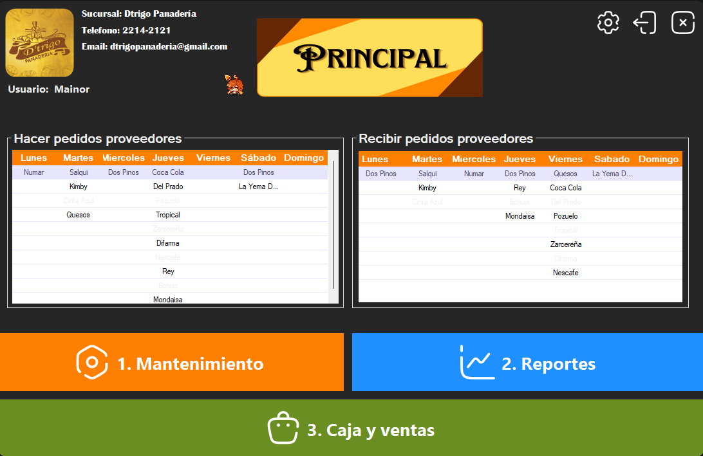

### 1. Maintenance & Inventory Management
This module manages all foundational elements used throughout the application. Key features include:
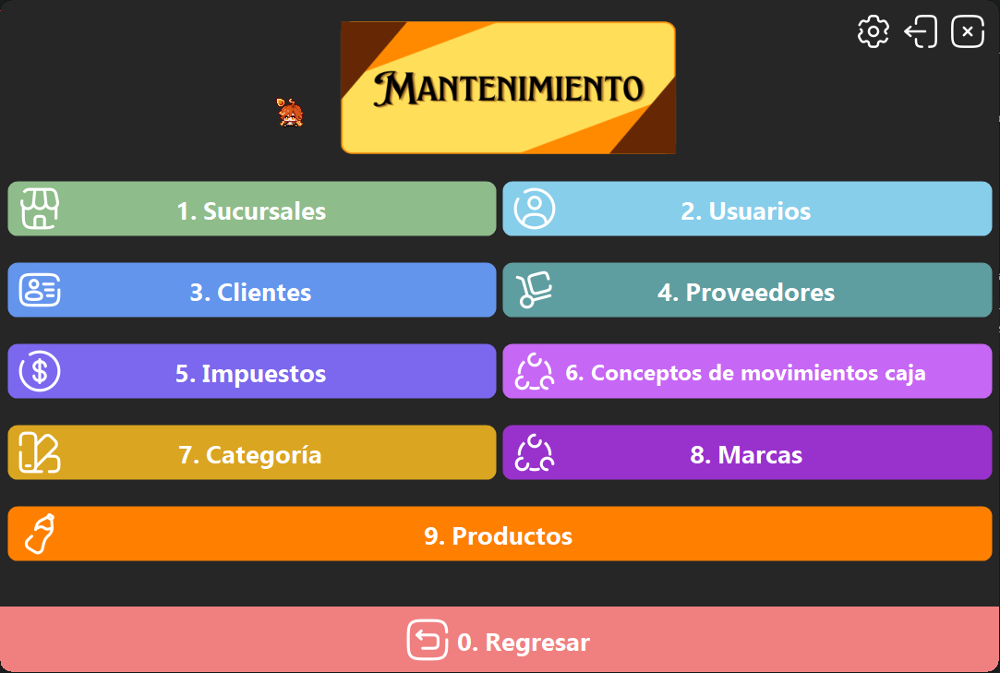
- **Branch Info:** Configure store details (logo, name, address, phone, email) reflected globally in the app and on printed receipts.
- **User Management:** Manage user accounts with color-coded identification for quick recognition. The system enforces Role-Based Access Control (RBAC) with two distinct roles: "Administrator" (full access) and "Cashier" (restricted to POS operations only). *(Note: The system includes a default admin account (user: `Admin`, password: `2004030`). It is highly recommended to change this password immediately after the first installation.)*
- **Clients:** Manage frequent customer profiles. *(Includes a default 'Generic' client out of the box).*
- **Suppliers:** Track supplier contact info and delivery schedules, visualized via a weekly supplier delivery calendar on the main dashboard.
- **Cash Movement Concepts:** Define custom reasons for cash entering or leaving the register, essential for accurate cash drawer reconciliations.
- **Categories & Brands:** Organize and filter products efficiently using custom taxonomies.

#### Product Maintenance
The core of the inventory module. Search, modify, delete, and add products with comprehensive details (code, name, description, brand, supplier, category, stock, base price, tax, profit margin, and selling price).
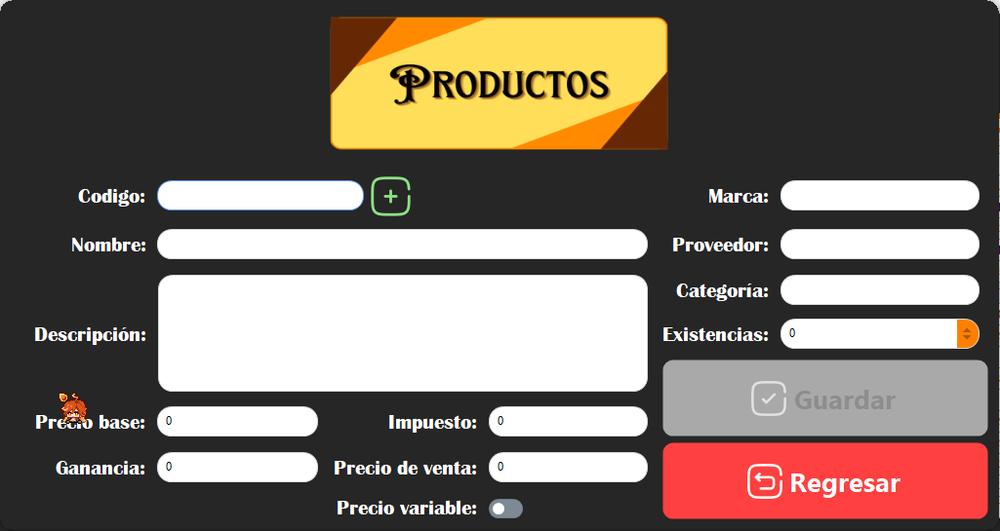
- **Advanced Filtering:** Filter by name, code, brand, category, supplier, or view recently added items.
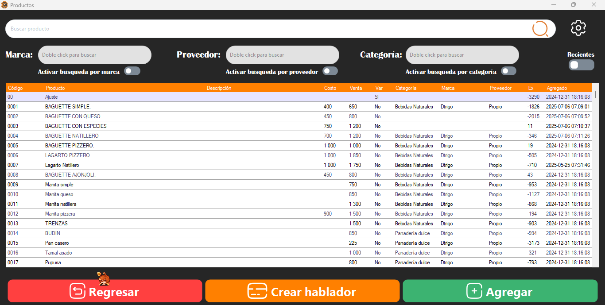
- **Dynamic Pricing Logic:** For standard products, the system automatically calculates the selling price based on base price, tax, and profit margin. For variable-price products (e.g., items sold by weight), the cashier defines the final price at the point of sale.
- **Price Tag Printing:** Generate small shelf labels (product name, code, and price) using the receipt printer. Users can select multiple products and specify the number of copies for each directly from the interface.
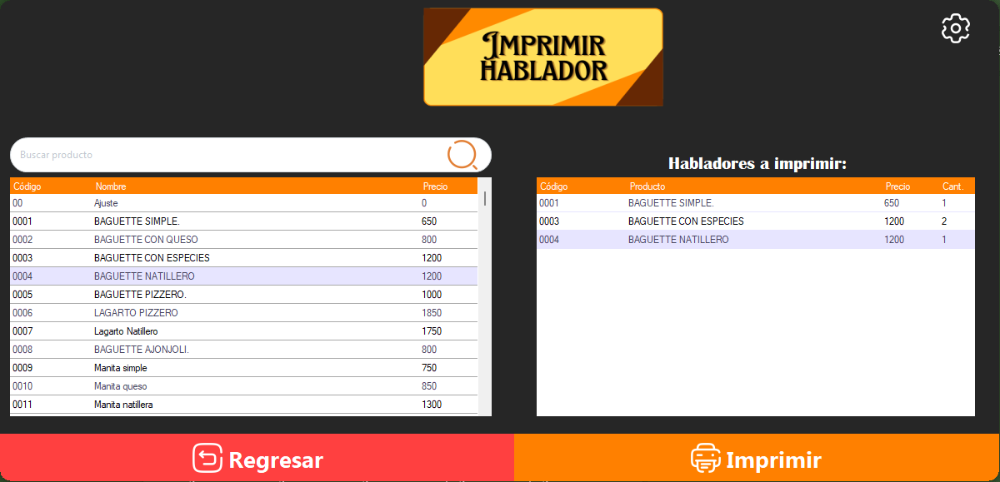

### 2. Billing & Sales (Point of Sale)
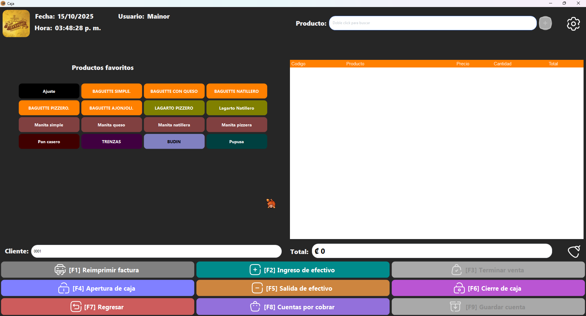
A highly customizable, comprehensive POS system designed to streamline and accelerate cashier workflows:
- Responsive interface adaptable to various screen sizes.
- Full compatibility with barcode scanners and readers.
- Direct, real-time product search from the POS interface.
- Interactive sales grid allowing manual quantity adjustments or easy item removal.
- Flexible payment processing: Cash, Card, Sinpe Móvil (Mobile Payment), Bank Deposits, and Mixed Payments, featuring automatic change calculation and split-payment utilities.
- Instant receipt generation upon sale completion, with a dedicated "Receipt Reprint" section for auditing past transactions.
- **Favorite Products Grid:** Unlimited customization of quick-access buttons for top-selling items, including custom reordering and individual button color-coding for rapid visual identification.
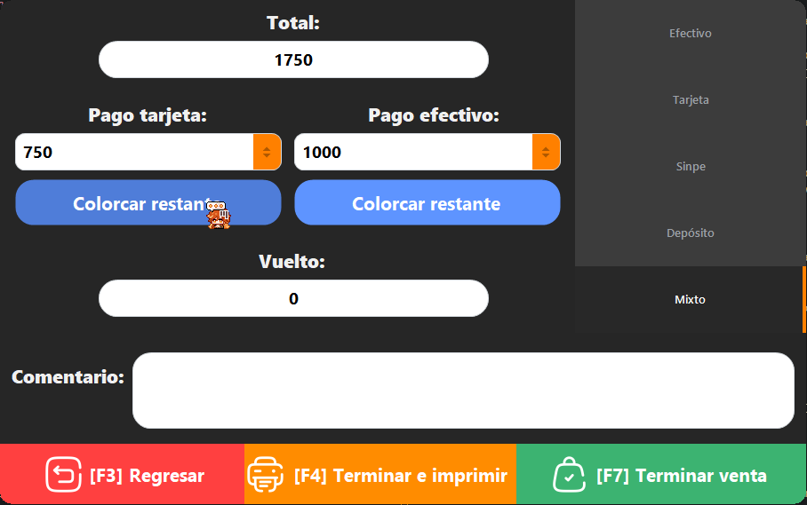

#### Accounts Receivable (CxC)
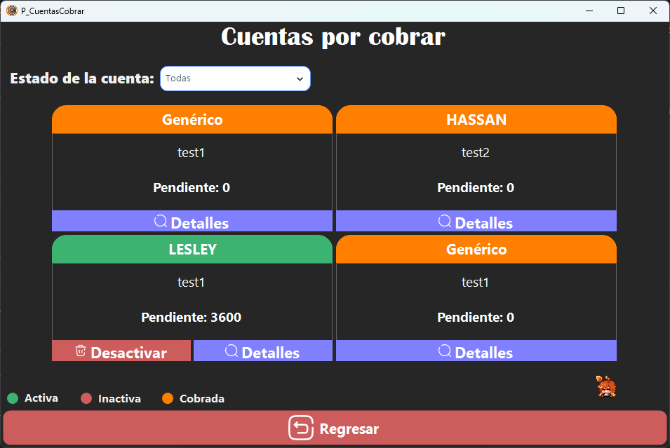
A dedicated module allowing cashiers to generate and manage credit sales directly from the POS:
- Save accounts receivable with custom comments and assigned clients.
- View and filter accounts by status (Active, Inactive, or Paid), each color-coded for clarity.
- Modify accounts via a dedicated CxC POS interface (update products, quantities, comments, or client details).
- Process partial payments or installments, printing specific installment receipts that show the remaining balance. Once fully paid, the account status updates to "Paid," and a final receipt can be printed.
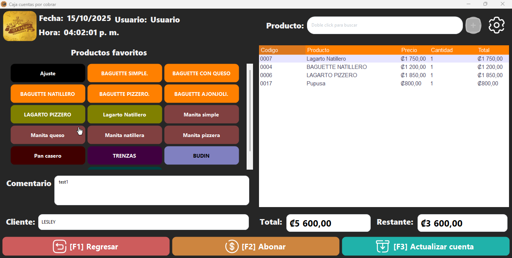

#### Cash Register Audits (Reconciliation)
An essential system for assigning cash drawer responsibility to specific cashiers during their shifts:
1. The cashier logs in and clicks "Open Register" (or presses `F4`).
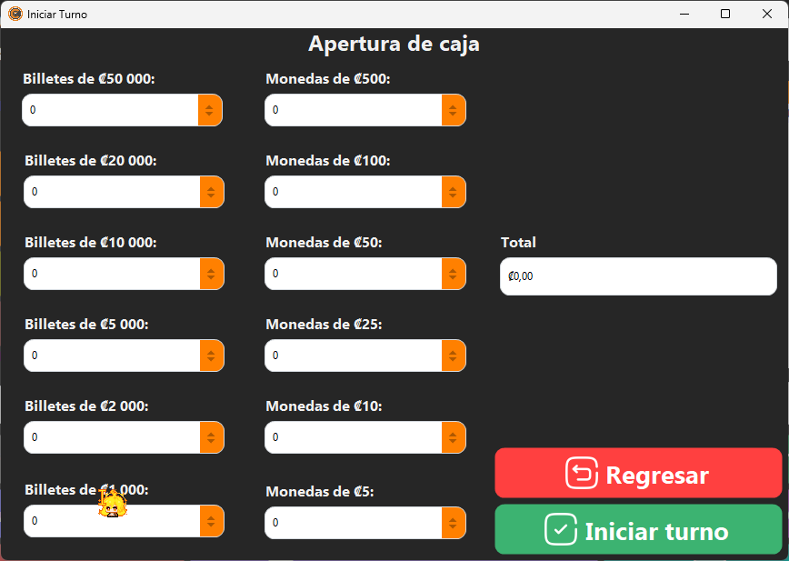
3. They count the starting cash in the drawer and click "Start Shift".
4. During the shift, any manual cash added or removed must be logged via "Cash In" or "Cash Out" (shortcuts `F2`/`F5`). The user must select a predefined concept and add a comment/invoice number for traceability. *(Normal sales are handled automatically).*
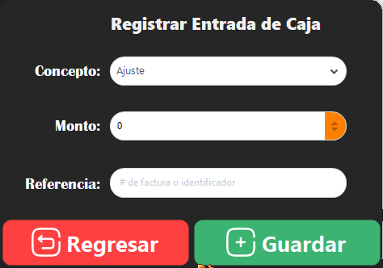
6. At the end of the shift, the cashier clicks "Close Register" (`F6`). Under supervisor supervision, they count the final cash. The system automatically calculates the absolute difference (in colones) and the percentage variance between the expected and actual cash.
7. Clicking "End Shift" returns the screen to the "Open Register" view for the next cashier, carrying over the closing balance as the new starting balance.
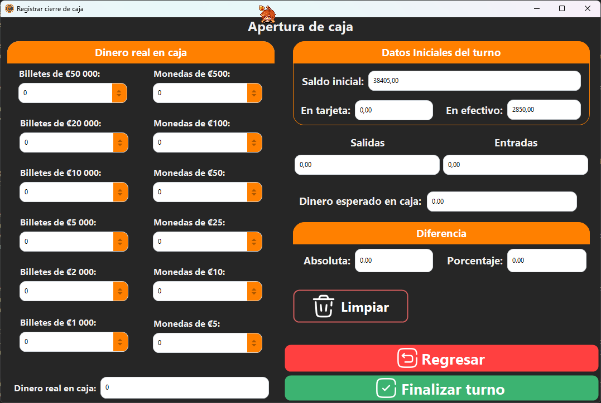

### 3. Reports
Administrators can analyze store performance in detail, generating visual reports within the app or exporting them as PDF documents:
- **General Sales Reports:** View total revenue, invoice count, payment method breakdown (Cash vs. Card/Mobile), and the top-performing product by sales volume within a specific date range.
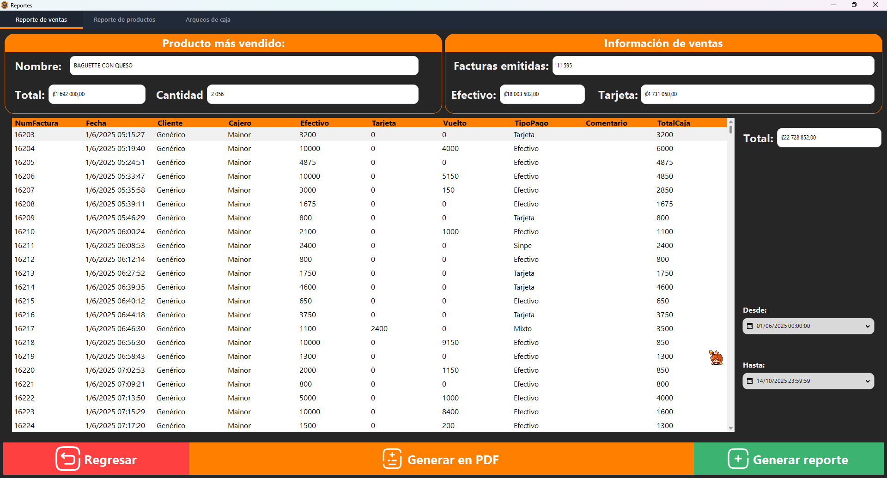
- **Product Sales Reports:** Generate sorted lists of top-selling products based on total revenue or quantity sold, filtered by specific criteria.
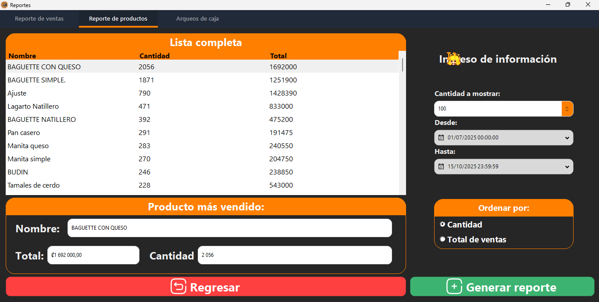
- **Cash Audit Reports:** Filter cash register reconciliations by cashier and date to analyze discrepancies and operational efficiency.
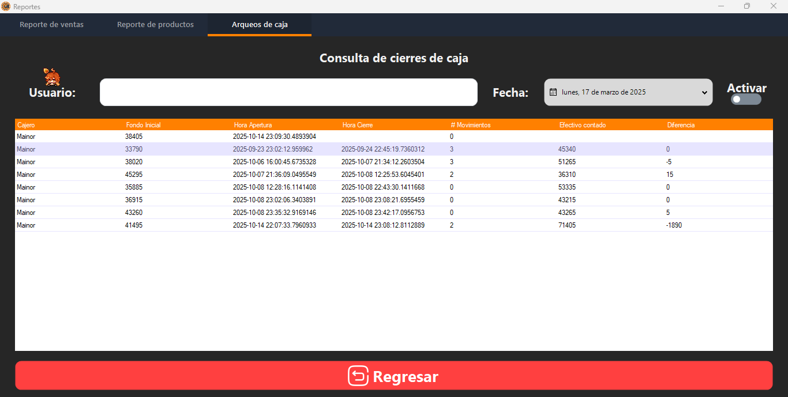
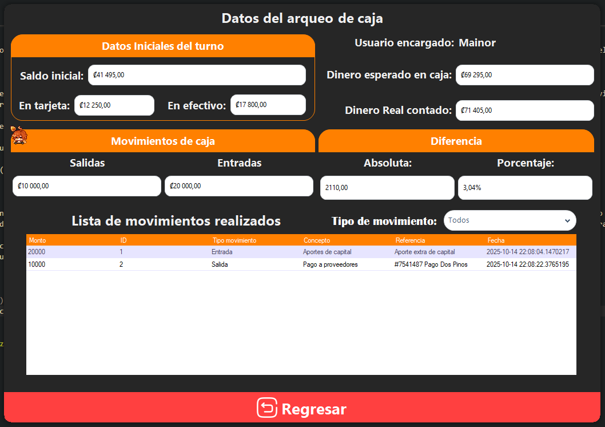

### 4. Configurations
A streamlined configuration system that adapts to the current module (e.g., opening auto-code settings in Maintenance, favorite products in Sales, or database settings in Reports):
- **App Info & Auto-Updates:** View application details, access the changelog, and configure automatic update checks on startup.
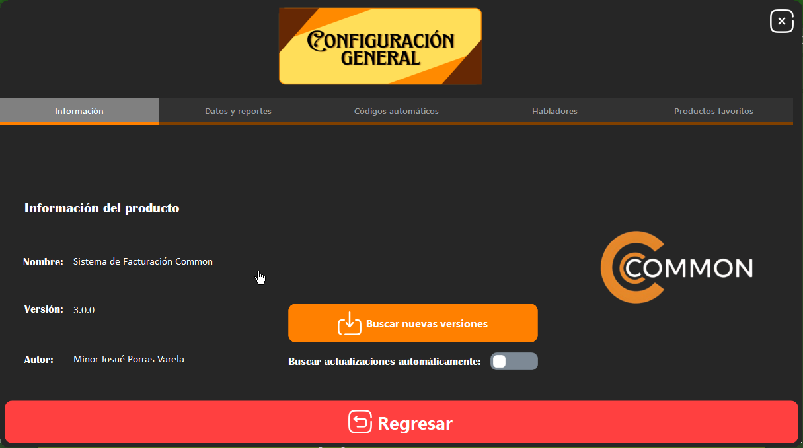
- **Database & Report Management:** Create database backups, restore from backups in case of data loss, and modify default directories for backups and PDF report downloads.
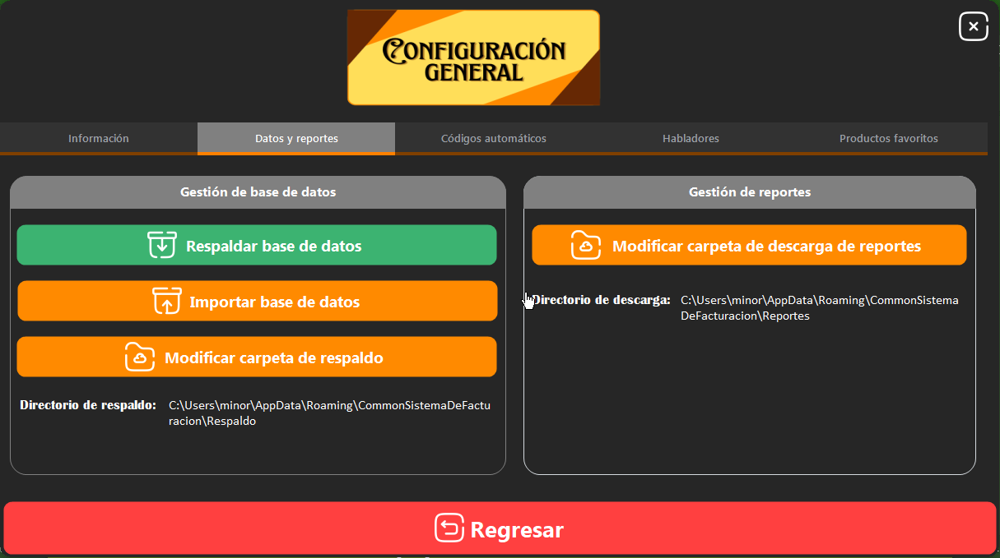
- **Auto-Code Generation:** Accelerate data entry by automatically generating the next available sequential code for customizable elements (e.g., if the highest 4-digit product code is `0162`, the system generates `0163`, or fills in any available gap like `0011`).
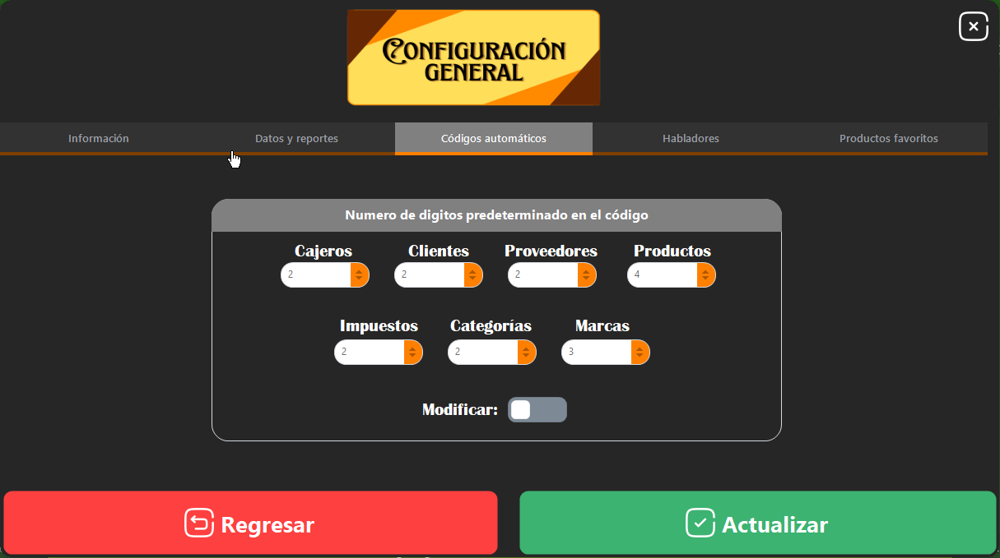
- **Price Tag Management:** Individually adjust the font size for product names and prices on printed shelf labels to fit specific printer requirements.
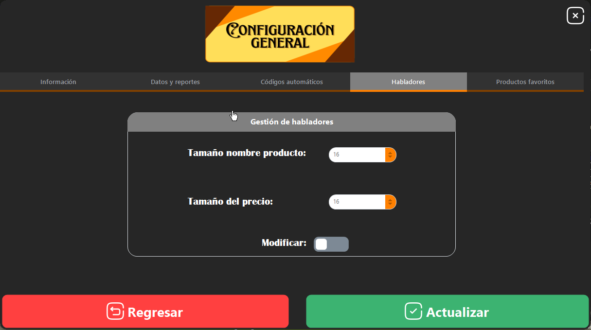
- **Favorite Products Management:** Add, reorder, color-code, or remove products from the POS quick-access grid, featuring a built-in search bar for rapid setup.
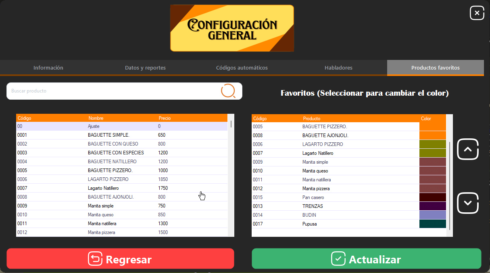
